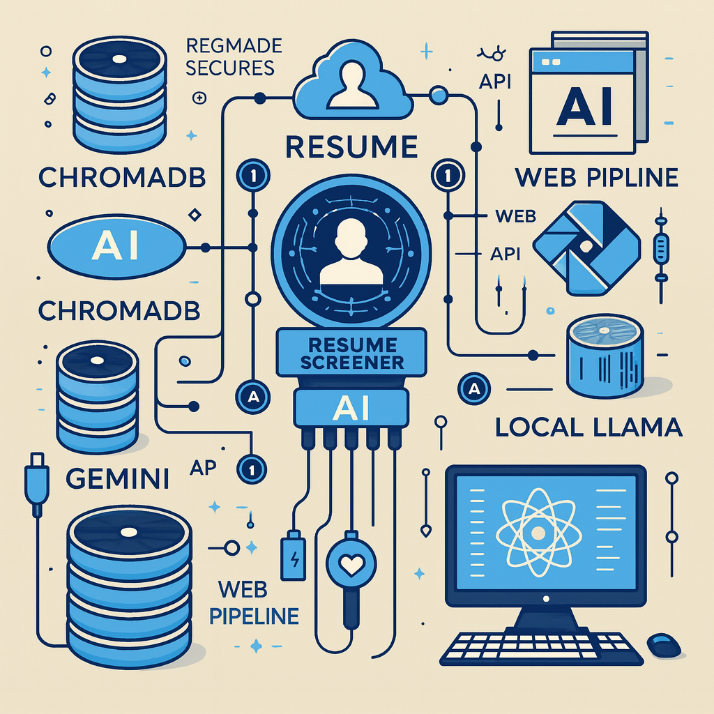

# 🤖 TalentScan AI — Intelligent Resume Screener

> An AI-powered resume screening and candidate analysis system built with **Retrieval-Augmented Generation (RAG)**, **LangChain**, **ChromaDB**, and **Google Gemini 1.5 Flash**.



---

## 🌟 Key Features

- **Automated PDF Resume Ingestion**: Parses, splits, and embeds PDF resumes into ChromaDB vector database.
- **RAG-Powered Candidate Q&A**: Uses hybrid similarity retrieval against the job description and candidate profiles to answer technical screening questions.
- **1-Click Demo Pre-loader**: Instantly seeds the database with sample candidate resumes and a full Job Description for quick, hassle-free presentations.
- **Modern Responsive UI**: Clean two-column interface built with React, Vite, and TailwindCSS featuring real-time system status indicators.
- **Markdown-Safe Output**: Renders structured candidate comparisons, skills matrices, and interview question suggestions safely with `react-markdown`.

---

## 🏗️ Architecture

```
User / Recruiter
      │
      ▼
┌──────────────────────────────────────────────────────────┐
│             React + Vite Frontend (Port 5173)            │
│  - Step 1: Upload Resumes & Target Job Description       │
│  - Step 2: Ask Questions / Suggested Query Chips        │
│  - Real-time Backend & Vector Store Status Badges       │
└────────────────────────────┬─────────────────────────────┘
                             │ REST API
                             ▼
┌──────────────────────────────────────────────────────────┐
│              Flask Backend API (Port 5000)               │
│  - /api/status       : System health, resumes count      │
│  - /api/upload       : Upload & index PDFs into Chroma   │
│  - /api/predict      : RAG query synthesis with Gemini   │
│  - /api/load-sample  : 1-click demo data seeder          │
│  - /api/reset        : Wipe uploads & vector DB          │
└────────────────────────────┬─────────────────────────────┘
                             │
            ┌────────────────┴────────────────┐
            ▼                                 ▼
┌───────────────────────┐         ┌────────────────────────┐
│  ChromaDB Vector DB   │         │  Google Gemini 1.5     │
│  - Document chunks    │         │  - Embeddings-001      │
│  - Semantic search    │         │  - Gemini 1.5 Flash    │
└───────────────────────┘         └────────────────────────┘
```

---

## ⚡ Quickstart Guide

### 1. Prerequisites
- **Python 3.10+**
- **Node.js 18+** & npm
- **Google Gemini API Key** (Free tier available at [Google AI Studio](https://aistudio.google.com/))

### 2. Environment Configuration
Create a `.env` file in the root directory (you can copy `.env.example`):
```bash
copy .env.example .env
```
Open `.env` and set your key:
```env
GOOGLE_API_KEY=AIzaSy...your_gemini_key_here
PORT=5000
```

### 3. Install Dependencies
```bash
# Python dependencies
pip install -r requirements.txt

# Frontend dependencies
cd frontend
npm install
cd ..
```

### 4. Run the Project
Launch both Backend and Frontend in one step:
```bat
start_project.bat
```
Or start them manually in two terminals:
- **Terminal 1 (Backend)**:
  ```bash
  python backend/app.py
  ```
- **Terminal 2 (Frontend)**:
  ```bash
  cd frontend
  npm run dev
  ```

Open your browser at **http://localhost:5173**.

---

## 🎬 3-Minute Live Demo Walkthrough

1. **Open the App**: Navigate to `http://localhost:5173`. Point out the system status badges in the top navbar (Backend Online, Resumes Count, API Key Status).
2. **One-Click Demo Setup**: Click the **"1-Click Demo Seed"** button in Step 1. In under 5 seconds, it loads 6 pre-bundled resumes and populates the Job Description without manual file searching.
3. **Execute AI Candidate Analysis**:
   - Click the prompt chip: *"Identify the top 3 candidates and explain why they fit this job description."*
   - Watch Gemini analyze the resumes against the JD context and generate structured rationale.
   - Click the prompt chip: *"Create a skills comparison matrix for all candidates against the requirements."*
   - Click *"Copy"* to grab the response.
4. **Custom Query**: Type a custom query, e.g.:
   > *"Which candidate has the most hands-on experience with Docker and CI/CD?"*

---

## 📁 Project Structure

```
resume-screener/
├── .env.example              # Sample environment configuration
├── requirements.txt          # Python package requirements
├── start_project.bat         # Single-command demo startup script
├── seed_demo_data.py         # Standalone CLI demo data seeder
├── README.md                 # Project documentation
│
├── backend/
│   ├── app.py                # Flask REST API endpoints
│   ├── rag_pipeline.py       # LangChain + ChromaDB pipeline
│   └── utils.py              # Gemini LLM invocation & prompt templates
│
├── bot/
│   └── data/pdfs/            # Bundled sample resumes for instant demo
│
├── frontend/
│   ├── src/
│   │   ├── App.jsx           # Main layout & system status badges
│   │   ├── ResumeUploader.jsx# PDF upload, JD input & 1-click seed
│   │   └── LLMQueryComponent.jsx # AI Q&A, suggested queries & markdown
│   ├── index.html
│   └── package.json
│
└── uploads/                  # Storage for uploaded PDFs & active JD
```

---

## 📄 License
This project is licensed under the MIT License.
